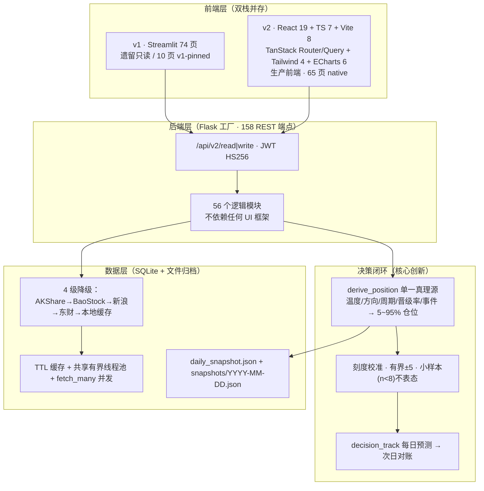

# 01 · 架构与工程亮点

> 面试前 10 分钟速记。每张图/每个数字都可在 [03-成果与数据.md](03-成果与数据.md) 查到来源。

## 一、系统架构（画在白板上就这张）

## 二、5 个能讲 2 分钟的技术决策（每个都带"为什么"和"代价"）

### 1. 决策闭环收敛到**单一实现入口** `derive_position(...)`

**问题**：仓位建议逻辑散落在多个页面时，改一处规则会让其他页面口径不一致，出现"同一个股两个页面给两个仓位"。
**做法**：所有页面只能调 `modules/decision.py::derive_position`，clamp 5%~95%；`overall_promo=None` 不加不减；`explain=True` 返回逐条 contributions 与敏感性。
**代价**：中心化带来单点耦合风险——所以配了 AST 守卫测试锁死"禁止页面自行实现仓位规则"，并用 `test_decision_data_freshness` 防注入脏数据。
**可讲点**：这是"用约束换一致性"的工程取舍，可延伸到微服务配置中心/单一真理源设计。

### 2. 数据新鲜度不是"有没有"，而是"权威数据日 vs 今天"

**问题**：数据源断更时，快照日期是今天但底层数据是 8 天前的——如果拿 `now()` 算滞后，会得出"新鲜"的错误结论。
**做法**：`_row_to_indicators` 必须带出 `row["date"][:10]`（权威数据日），`FRESH_WARN_DAYS=4` 封顶 60%、`FRESH_STALE_DAYS=8` 封顶 40%；33 个守卫测试锁死。
**代价**：数据越旧仓位越保守，牺牲"看起来能用"换"不误导人"。
**可讲点**：数据血缘与时效性治理，是量化系统最容易被忽视的生产级问题。

### 3. 刻度校准三条铁律 —— "可自纠偏但不靠小样本过拟合"

**问题**：想让系统从历史中学习调整建议幅度，但小样本极易过拟合。
**做法**：`sug_delta = clamp(2 × 次日平均涨跌, ±5)`；T1 只建议不写文件；T2 有界 ±5；T3 `n_call < 8` 不出行。
**代价**：T1 阶段自动化程度有限，需要人工/阈值采纳——**这是有意设计，不是缺陷**（论文 7.2 明确写）。
**可讲点**：在线学习系统的探索/约束平衡，可讲成"保守强化学习 + 硬护栏"。

### 4. 前端双栈并存而非一刀切迁移

**问题**：v1 Streamlit 74 页有大量页面逻辑与实盘红线端点；v2 React 需要现代化交互但不可能一夜重写。
**做法**：四档分类——native（v2 真承接）/ data（仅数据展示）/ v1-pinned（保留 v1 直达）/ v1-only（实盘交易，永久留 v1）。用 `v2Mapping.ts` 单一清单驱动导航与守卫测试，**65 native / 9 v1-pinned**；C 类实盘红线永久不迁。
**代价**：双栈维护成本高——所以明令"禁新增任何 Streamlit 页面/功能"，v1 只读逐步淘汰。
**可讲点**：渐进式重构策略、遗留系统绞杀者模式（Strangler Fig），以及"什么不该迁移"的产品判断力。

### 5. 生成物诚实性守卫 —— 专治"能跑但语义错"

**问题**：把缺失数据喂给图表或导出，页面显示 0 或空表，看起来"跑通了"但其实在骗人。
**做法**：AST 静态守卫扫描"被调方真读的键/列"与"调用方实际喂的数据"比对；取数不足就跳过不产出；`pytest.skip` 只允许环境不具备，数据疑似被覆盖/样本异常必须 fail（防止守卫自我静音）。
**代价**：守卫会拒绝一些"差不多能用"的产出，开发时偶尔被自己的守卫拦红。
**可讲点**：从"测试覆盖率"进阶到"测试语义有效性"——这是从写测试到写守卫的工程成熟度跃迁。

## 三、技术栈清单（对标最新稳定版）

| 层 | 技术 | 版本 | 备注 |
|---|---|---|---|
| v2 前端 | React / TypeScript / Vite | 19.3.1 / 7.0.2 / 8.3.6 | 生产前端 |
|  | TanStack Router / Query | 1.170.46 / 5.106.1 | 路由与服务端状态 |
|  | Tailwind CSS / ECharts | 4.3.4 / 6.1.0 | 样式与图表 |
|  | Zustand / Zod / MSW / Vitest | 5.0.16 / 4.6.7 / 2.7.0 / 5.1.0 | 状态/校验/模拟/测试 |
| 后端 | Flask + JWT HS256 | 见 requirements.txt | 工厂模式，158 端点 |
| 数据 | SQLite + 本地 JSON 归档 | — | 无外部数据库依赖 |
| 遗留前端 | Streamlit | 见 requirements.txt | 只读，禁止新增功能 |

## 四、量化规模（来源见 03 号文件）

- **74** 功能页 / **158** REST 端点 / **4760** 自动化测试 / **517** 测试文件
- **138/138** 双主题真浏览器路由审计通过（69 页 × light/dark）
- **49.1%** 决策闭环离线回测方向命中率（1722/3507，诚实负结果）
- **10000 用户** 虚拟并发模拟、1 小时 1 次 P1 同步调度
